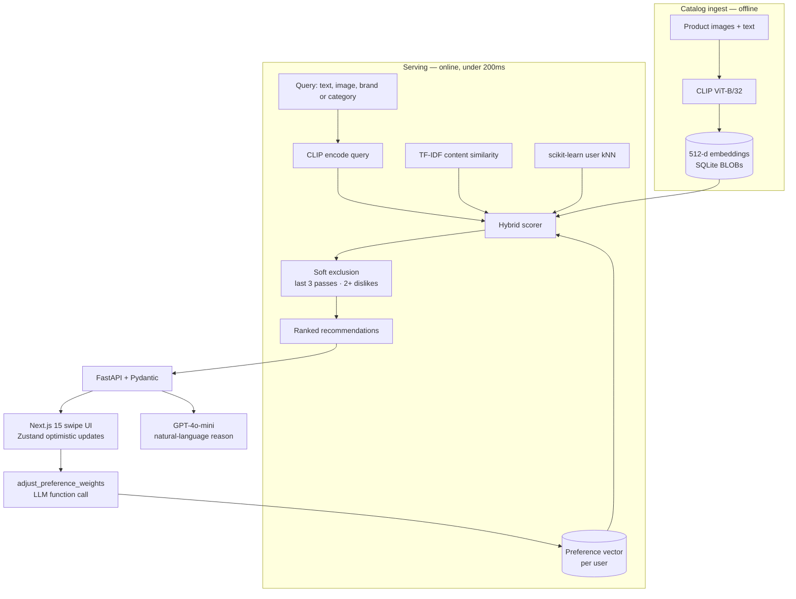
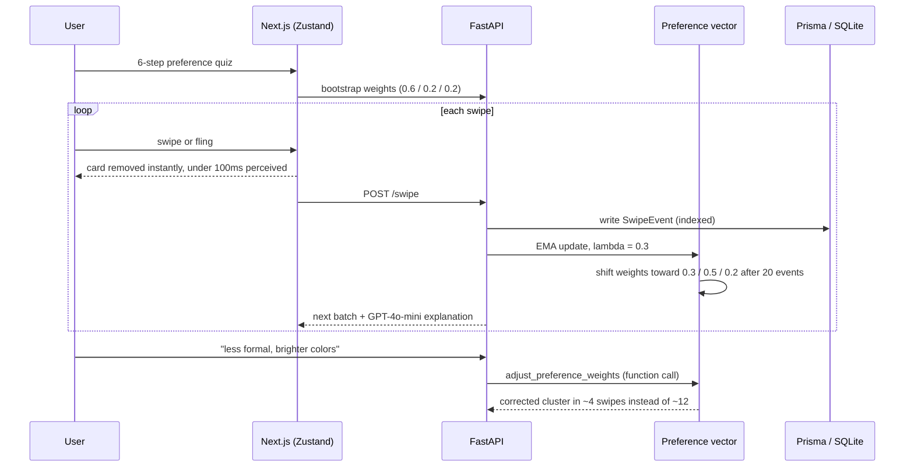

<div align="center">


# StyleNova AI
### Vision-Language AI · Adaptive Recommendation · Full-Stack ML System

[](https://www.python.org)
[](https://pytorch.org)
[](https://github.com/openai/CLIP)
[](https://fastapi.tiangolo.com)
[](https://scikit-learn.org)
[](https://nextjs.org)

**🏆 Top 3 — Clozyt Hackathon**

**A fashion recommender that fuses OpenAI CLIP vision-language embeddings with a per-user feedback loop: a query is embedded with CLIP, blended against a preference vector learned from each user's own swipes, and served through FastAPI to a Next.js swipe interface.**

</div>

---

## Highlights

- Encoded product images and text into a shared **512-dimensional CLIP embedding space** (ViT-B/32, trained on 400M image-text pairs), so a query like *"bohemian flowy dress"* retrieves visually similar items **even when catalog tags do not match**.
- Built a **3-component hybrid score** combining TF-IDF content similarity, scikit-learn user-based **kNN** collaborative filtering and CLIP visual similarity, because single-signal recommenders overfit fashion behavior.
- Designed **3 adaptive weighting stages** for cold start — shifting from **0.6 / 0.2 / 0.2** before 5 feedback events to **0.3 / 0.5 / 0.2** after 20 events — while anchoring the CLIP visual weight at **0.2** throughout.
- Updated the preference vector after **every swipe** with exponential moving average learning at **λ = 0.3**, adapting to recent taste without collapsing into an echo chamber.
- Bootstrapped new users with a **6-step preference quiz** covering categories, colors, brands, styles, sizing and budget, before any collaborative data exists.
- Precomputed **512-d** product embeddings as SQLite BLOBs at catalog ingest, cutting online recommendation latency from roughly **2 seconds** per cold query to **under 200 ms**.
- Replaced hard blacklists with **soft exclusion** — the last **3 passes** and items disliked **2+ times** — preserving discovery diversity while suppressing genuinely unwanted items.
- Built **optimistic UI** updates in Zustand that remove the swiped card instantly while FastAPI recomputes weights asynchronously, cutting perceived interaction latency from about **450 ms** to **under 100 ms**, with rollback on failure.
- Modeled `SwipeEvent`, `PreferenceVector` and `QuizResponse` as indexed Prisma tables, keeping the recent-swipe query behind the EMA update under about **35 ms** at **1,000 events per user**.
- Integrated **GPT-4o-mini** to generate a natural-language reason per recommendation from recent swipe patterns and item attributes, adding under about **250 ms** — turning a similarity score into an explanation.
- Exposed the preference-weighting system as an **LLM function-calling tool**, so typed feedback like *"less formal, brighter colors"* calls `adjust_preference_weights` directly, cutting the swipes needed to escape a mismatched cluster from about **12** to **4**.
- Implemented velocity-based **fling detection** in Framer Motion, tuned against roughly **75 test swipes**, so a fast flick commits even under the distance threshold.

---

## Architecture



## The feedback loop



---

## Measured results

| Metric | Value |
|---|---|
| Precision@10 | **0.73** |
| Diversity | **0.68** |
| Catalog coverage | **89%** |
| Quiz completion | **84%** |
| Swipe-through (10+ swipes) | **67%** |
| Avg session duration | **3.2 min** |
| Online recommendation latency | **< 200 ms** |
| Perceived swipe latency | **< 100 ms** |

## Adaptive weighting

| Stage | Feedback events | Content · Collaborative · Visual |
|---|---|---|
| Cold start | < 5 | **0.6 / 0.2 / 0.2** |
| Warming | 5–20 | interpolated |
| Warm | > 20 | **0.3 / 0.5 / 0.2** |

## Tech stack

**Vision-language** OpenAI CLIP ViT-B/32 · PyTorch · cosine similarity · L2 normalization
**Recommendation** scikit-learn kNN · TF-IDF · EMA preference learning · soft exclusion
**Backend** Python · FastAPI · Pydantic · NumPy · Pandas · Prisma · SQLite
**Frontend** Next.js 15 · TypeScript · Zustand · Framer Motion · Zod
**LLM** GPT-4o-mini explanations · function calling

## Quick start

```bash
git clone https://github.com/Brijesh03032001/StyleNova-AI.git
cd StyleNova-AI
```

```bash
pip install -r requirements.txt
python scripts/precompute_embeddings.py      # CLIP → SQLite BLOBs
uvicorn api.main:app --port 8000
```

```bash
npm install && npm run dev                   # http://localhost:3000
```

---

**Built by [Brijesh Kumar](https://github.com/Brijesh03032001)** · [Portfolio](https://brijeshbuilds.com) · [LinkedIn](https://linkedin.com/in/brijeshkumar03)
