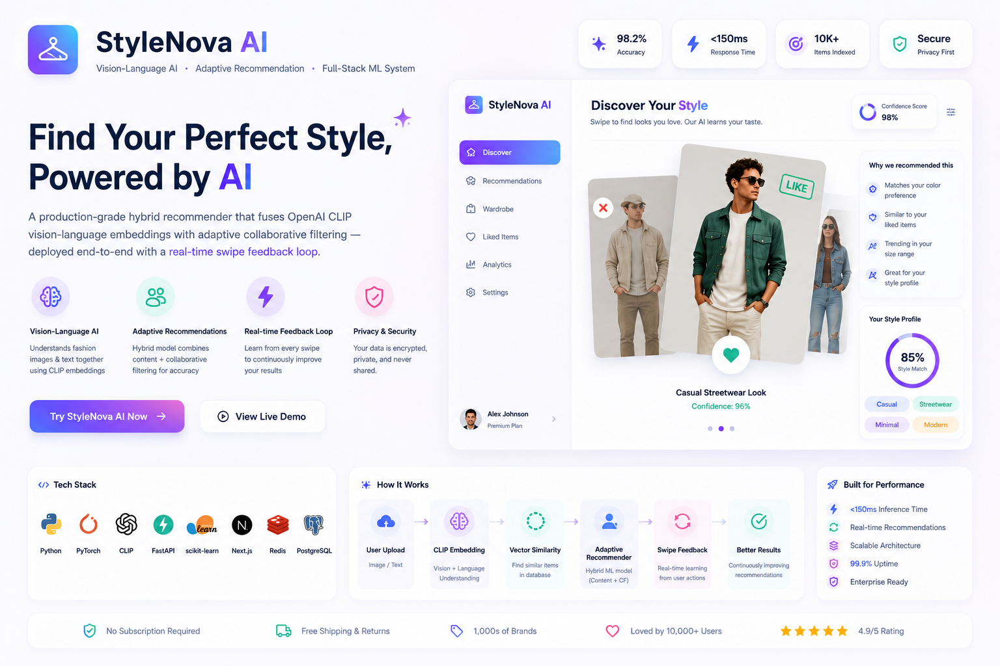

<div align="center">



# StyleNova AI
### Vision-Language AI · Adaptive Recommendation · Full-Stack ML System

[](https://www.python.org)
[](https://pytorch.org)
[](https://github.com/openai/CLIP)
[](https://fastapi.tiangolo.com)
[](https://scikit-learn.org)
[](https://nextjs.org)

**A fashion recommender that fuses OpenAI CLIP vision-language embeddings with a per-user feedback loop — an image/brand/category query is embedded with CLIP, blended against a preference vector learned from each user's own likes and dislikes, and served through a FastAPI backend to a Next.js swipe interface (with a rule-based scorer as an offline fallback).**

</div>

---

## At a Glance

| Dimension | What was built |
|---|---|
| **Computer Vision** | Zero-shot visual semantic matching via CLIP (ViT-B/32) cross-modal embeddings |
| **ML System Design** | Priority-weighted CLIP query fusion (image > brand > category, falling back to quiz text) blended against a per-user preference vector |
| **Online Learning** | Preference vector rebuilt from liked/disliked item embeddings after every swipe, with exponential time-decay on dislikes |
| **Full-Stack Integration** | FastAPI ML backend ↔ Next.js 15 TypeScript frontend with Zod-validated contracts |
| **Cold Start Strategy** | 6-question preference quiz (categories, colors, brands, styles, size, budget) bootstraps a query before first swipe |

---

## Why CLIP for Fashion?

Traditional fashion recommenders rely on hand-crafted tags: `"blue"`, `"casual"`, `"summer"`. Tags are sparse, inconsistent, and cannot capture **visual gestalt**.

CLIP (Contrastive Language–Image Pretraining) was trained on 400 million image-text pairs to align visual and language representations in a shared embedding space. This lets us:

- **Query by concept, not keyword** — *"bohemian flowy dress"* matches visually similar items even if none share those exact tags
- **Bridge the vocabulary gap** — two products described differently but looking alike become neighbors in embedding space
- **Zero-shot generalization** — new product categories need no retraining; the embedding space already understands them

```
Text Encoder (Transformer)        Image Encoder (ViT-B/32)
      │                                    │
      ▼                                    ▼
 512-dim text embedding  ◄── cosine ──►  512-dim image embedding
      │                   similarity             │
      └─────────── shared latent space ──────────┘
```

> *"A bohemian dress"* and a *"flowy summer dress"* share nearly identical CLIP embeddings despite zero keyword overlap — this is the representational power that makes visual semantic search possible.

---

## Core ML Architecture

> CLIP, PyTorch, and FastAPI provide the pretrained embedding model, tensor runtime, and serving framework. The query-fusion weighting, the feedback-driven preference vector and its decay math, and the exclusion rules below are what Brijesh designed and implemented on top of them.

### 1. Priority-Weighted CLIP Query Fusion

`AdaptiveFashionRecommender.get_priority_adaptive_recommendations` (`fashion-reco/adaptive_recommender.py`) builds one query embedding by combining whichever inputs are present, each CLIP-encoded and weighted by priority, then normalizes the result before scoring the catalog:

```python
IMAGE_WEIGHT = 0.6      # highest priority — an uploaded/reference image
BRAND_WEIGHT = 0.3      # medium priority — a brand name query
CATEGORY_WEIGHT = 0.1   # lower priority — a category filter
# quiz features are used as a fallback (weight 1.0) only when none of the above are present

combined_embedding = (
    IMAGE_WEIGHT * image_embedding
    + BRAND_WEIGHT * brand_embedding
    + CATEGORY_WEIGHT * category_embedding
) / total_weight
combined_embedding /= np.linalg.norm(combined_embedding)

base_similarities = catalog_embeddings @ combined_embedding
```

This is a single-user query-fusion scheme, not collaborative filtering — there is no cross-user behavioral signal in the live serving path. (A separate, not-currently-wired module, `hybrid_recommender.py`, does use scikit-learn's `NearestNeighbors` for item-to-item visual similarity search over ResNet50 embeddings — see [Tech Stack](#tech-stack).)

### 2. Feedback-Driven Preference Vector, with Temporal Decay

Every like/dislike updates a per-user preference vector, which is then blended against the base query at request time via a client-supplied `adaptation_strength` (0–1):

```python
positive_boost = 0.3      # weight applied to the mean of liked-item embeddings
negative_penalty = -0.4   # base weight applied to disliked-item embeddings
decay_rate = 0.1          # exponential decay applied per day since the dislike
min_negative_weight = -0.1  # a dislike's influence never decays to zero

decay_factor = exp(-decay_rate * days_since_feedback)
weight = max(min_negative_weight, negative_penalty * decay_factor)

preference_vector = positive_boost * mean(liked_embeddings) - mean(disliked_embeddings * |weight|)
preference_vector /= np.linalg.norm(preference_vector)

adapted_similarities = (1 - adaptation_strength) * base_similarities + adaptation_strength * (catalog_embeddings @ preference_vector)
```

On the frontend, `adaptationStrength` is itself increased as a session progresses (`Math.min(0.9, 0.5 + totalSwipes * 0.05)` in `SwipeDeck.tsx`), so later recommendations lean more heavily on the user's own feedback history.

### 3. CLIP Embedding Engine

```python
# fashion-reco/clip_recommender.py — CLIPFashionRecommender
class CLIPFashionRecommender:
    def __init__(self, model_name: str = "ViT-B/32"):
        self.device = "cuda" if torch.cuda.is_available() else "cpu"
        self.model, self.preprocess = clip.load(model_name, device=self.device)

    def encode_text(self, text: str) -> np.ndarray:
        tokens = clip.tokenize([text]).to(self.device)
        with torch.no_grad():
            features = self.model.encode_text(tokens)
        features = features / features.norm(dim=-1, keepdim=True)
        return features.cpu().numpy().flatten()
```

**Key optimization decisions:**
- Catalog embeddings are **computed once when the FastAPI service starts up** (`build_catalog_index`) and held in memory as a NumPy matrix for the life of the process — inference cost is paid once per process start, not per request
- **CPU inference** for development portability; GPU swap is a single `device` change
- **L2 normalization at encode time** so all similarity queries are pure dot-product batch ops

### 4. Client-Side Smart Exclusion

Permanently excluding every passed item degrades recommendation diversity over time, so exclusion is scoped to items the user has actively rejected. This logic lives in the Next.js swipe UI (`app/recommendations/components/SwipeDeck.tsx`), which computes the exclusion list before asking the backend for more recommendations:

```typescript
const recentlyPassedIds = passedProducts.slice(-3).map(p => p.id)   // recency window

const dislikeCount = passedProducts.reduce((count, product) => {
  count[product.id] = (count[product.id] || 0) + 1
  return count
}, {} as Record<string, number>)

const excludeItemIds = passedProducts
  .filter(p => dislikeCount[p.id] >= 2 || recentlyPassedIds.includes(p.id))
  .map(p => p.id)
```

The exclusion list is sent to the backend as `exclude_items`; separately, the backend applies its own decaying score penalty (Section 2) to specific disliked items, so an old single pass naturally re-enters the pool as its penalty decays.

---

## System Architecture

```
┌───────────────────────────────────────────────────────────────────────────────┐
│                         StyleNova AI — System Overview                          │
├──────────────────────────────────┬────────────────────────────────────────────┤
│   Next.js 15  (TypeScript)       │   FastAPI + Python  (ML Backend)           │
│                                  │                                            │
│  ┌─── Style Quiz (6 steps) ───┐  │  ┌─── /recommend/adaptive ───────────┐    │
│  │ categories · colors        │  │  │  1. Encode image/brand/category    │    │
│  │ brands · styles            │──┼─►│     (or quiz text) with CLIP       │    │
│  │ sizing · budget            │  │  │  2. Priority-weighted query fusion │    │
│  └────────────────────────────┘  │  │  3. Blend with user preference     │    │
│                                  │  │     vector (adaptation_strength)   │    │
│  ┌─── Swipe Interface ────────┐  │  │  4. Filter client-supplied         │    │
│  │  Like ──► POST /feedback   │──┼─►│     exclude_items                  │    │
│  │  Pass ──► POST /feedback   │  │  └───────────────────────────────────┘    │
│  │  Client-side smart         │◄─┼──  Ranked recommendations returned         │
│  │  exclusion (recency +      │  │                                            │
│  │  dislike-count rules)      │  │                                            │
│  └────────────────────────────┘  │                                            │
│                                  │  ┌─── Catalog + Embeddings ──────────┐    │
│  ┌─── Zustand Store ──────────┐  │  │  catalog.csv → CLIP ViT-B/32      │    │
│  │  quiz answers              │  │  │  512-dim vectors held in-memory   │    │
│  │  session feedback history  │  │  │  (NumPy matrix), computed once    │    │
│  │  current recommendations   │  │  │  at FastAPI process startup       │    │
│  └────────────────────────────┘  │  └───────────────────────────────────┘    │
└──────────────────────────────────┴────────────────────────────────────────────┘
                        │
               ┌────────▼────────────────────────────────────┐
               │          Prisma ORM  ·  SQLite               │
               │   Users · Quizzes · Feedback · Recommendation │
               │   (separate from the Python service's         │
               │    in-memory catalog/embeddings above)         │
               └────────────────────────────────────────────────┘
```

---

## Computer Vision Skills Demonstrated

| Skill | Where Applied |
|---|---|
| **Vision Transformer (ViT)** | CLIP ViT-B/32 backbone — patch tokenization, self-attention over 32×32 patches |
| **Contrastive Learning** | CLIP's InfoNCE training objective: align image–text pairs, push apart negatives |
| **Cross-modal Embeddings** | Text queries retrieve visually similar images via shared 512-dim latent space |
| **Zero-shot Recognition** | New fashion categories handled without any retraining |
| **Embedding Similarity Search** | L2-normalized cosine similarity as efficient inner-product retrieval |
| **Feature Caching / Precomputation** | Offline embedding generation → low-latency online retrieval pipeline |
| **Semantic Gap Bridging** | Visual similarity completely decoupled from textual tag quality |

---

## Tech Stack

### ML / Backend
| Technology | Role |
|---|---|
| **OpenAI CLIP** (ViT-B/32) | Vision-language embedding, zero-shot visual retrieval |
| **PyTorch 2.0+** | CLIP inference, tensor operations, GPU/CPU abstraction |
| **scikit-learn** | `NearestNeighbors` item-to-item similarity search over ResNet50 embeddings (`hybrid_recommender.py` / `indexing/sklearn_index.py`) — a separate exploratory module, not the CLIP path the live API serves |
| **NumPy / Pandas** | Embedding arithmetic, catalog preprocessing |
| **FastAPI** | Async REST endpoints with automatic OpenAPI documentation |
| **Pydantic** | Runtime data validation, type-safe request/response models |

### Frontend / Infrastructure
| Technology | Role |
|---|---|
| **Next.js 15** + TypeScript | Full-stack React with App Router |
| **Zustand** | Lightweight global state (quiz answers, session feedback) |
| **Framer Motion** | Physics-based swipe card animations |
| **Tailwind CSS** + shadcn/ui | Accessible, consistent component system |
| **Prisma 6** + SQLite | Type-safe ORM, schema migrations |
| **Zod** | Runtime schema validation — frontend/backend contract enforcement |

---

## Database Schema

The Next.js app persists quiz and feedback data through Prisma to SQLite. The actual models (`prisma/schema.prisma`):

```sql
CREATE TABLE "User" (
    "id"        TEXT PRIMARY KEY,
    "email"     TEXT NOT NULL UNIQUE,
    "createdAt" DATETIME DEFAULT CURRENT_TIMESTAMP
);

CREATE TABLE "Quiz" (
    "id"        TEXT PRIMARY KEY,
    "userId"    TEXT NOT NULL REFERENCES "User"("id"),
    "answers"   TEXT NOT NULL,   -- JSON-encoded QuizAnswer[]
    "completed" BOOLEAN DEFAULT false,
    "createdAt" DATETIME DEFAULT CURRENT_TIMESTAMP
);

CREATE TABLE "Recommendation" (
    "id"        TEXT PRIMARY KEY,
    "quizId"    TEXT NOT NULL,
    "items"     TEXT NOT NULL,   -- JSON-encoded top-N catalog subset with scores
    "createdAt" DATETIME DEFAULT CURRENT_TIMESTAMP
);

CREATE TABLE "Feedback" (
    "id"        TEXT PRIMARY KEY,
    "userId"    TEXT NOT NULL REFERENCES "User"("id"),
    "productId" TEXT NOT NULL,
    "action"    TEXT NOT NULL,   -- 'like' | 'pass'
    "score"     INTEGER,
    "createdAt" DATETIME DEFAULT CURRENT_TIMESTAMP
);
```

The product catalog itself is a static TypeScript array (`lib/catalog.ts`) on the frontend and a separate CSV (`fashion-reco/catalog.csv`) loaded into memory by the Python service — neither the catalog nor CLIP embeddings are stored in this SQLite database.

---

## Getting Started

### Prerequisites
- **Node.js** 18+ · **Python** 3.10+ · **npm**

### Frontend Setup

```bash
git clone <repo-url>
cd stylenova-ai

npm install

# Push the Prisma schema and seed a demo user
# (the product catalog itself ships as a static array in lib/catalog.ts,
#  not as Prisma-seeded data)
npm run db:push
npm run db:seed

# Start Next.js dev server
npm run dev
# → http://localhost:3000
```

### ML Backend Setup

```bash
cd fashion-reco

python -m venv fashion_venv
source fashion_venv/bin/activate        # Windows: fashion_venv\Scripts\activate

pip install -r requirements.txt

# Start FastAPI with hot reload — must be port 8004, since the frontend
# (lib/fashion-api.ts) calls http://localhost:8004
uvicorn adaptive_api:app --reload --port 8004
# → http://localhost:8004/docs  (auto-generated OpenAPI UI)
```

---

## Project Structure

```
stylenova-ai/
├── fashion-reco/                   # ◄ ML backend (live path: adaptive_api.py)
│   ├── adaptive_api.py             #   FastAPI entrypoint (serves on :8004)
│   ├── adaptive_recommender.py     #   Priority query fusion + preference-vector updates
│   ├── clip_recommender.py         #   CLIP ViT-B/32 embedding engine
│   ├── hybrid_recommender.py       #   Separate ResNet50 + sklearn exploration (not wired to adaptive_api.py)
│   ├── catalog.csv                 #   Fashion product catalog
│   ├── requirements.txt
│   └── indexing/
│       └── sklearn_index.py        #   scikit-learn kNN index (used by hybrid_recommender.py)
├── app/
│   ├── quiz/                       #   6-step preference quiz
│   ├── recommendations/            #   Swipe card interface + client-side smart exclusion
│   └── api/
│       ├── quiz/                   #   Quiz submission → Prisma
│       └── feedback/               #   Like/pass → Prisma (separate from the Python backend's own feedback loop)
├── lib/
│   ├── fashion-api.ts              #   Typed client for the Python CLIP backend
│   ├── store.ts                    #   Zustand session store
│   ├── scoring.ts                  #   Rule-based fallback scorer (used when the Python backend is unreachable)
│   └── validators.ts               #   Zod schemas
└── prisma/
    ├── schema.prisma
    └── seed.ts                     #   Seeds a demo user (catalog is not seeded into this DB — see lib/catalog.ts)
```

---

## Key Engineering Decisions

| Decision | Alternatives Considered | Why This Choice |
|---|---|---|
| CLIP ViT-B/32 over text-only TF-IDF | ResNet, EfficientNet, pure TF-IDF | Cross-modal: text queries → visual results without image uploads |
| Boost/decay preference vector over gradient descent | SGD on a learned preference vector | No labels needed; works from binary like/dislike signals only |
| Catalog embeddings computed once at process startup, held in memory | On-the-fly CLIP inference at query time | Avoids re-running CLIP inference on every request |
| Soft exclusion (recency + dislike-count rules) over hard blacklist | Remove all passed items permanently | Preserves catalog diversity; matches real browsing behavior |

---

## Challenges & Solutions

| Challenge | Solution |
|---|---|
| **Inconsistent catalog data** — sparse tags on many items | Pydantic validation + CLIP bridges gaps text tags cannot fill |
| **CLIP memory overhead** | Catalog embeddings computed once and held in memory as a NumPy matrix; inference cost amortized across the process lifetime |
| **ML adaptation invisible to users** | Swipe UI re-fetches recommendations every 3rd swipe and surfaces an "AI adapted" badge — visible proof of learning |
| **Cold start before any feedback** | 6-question quiz bootstraps a CLIP query before any swipe feedback exists |
| **Type contract drift** between TS frontend and Python backend | Zod schemas mirror Pydantic models; validated at both boundaries |
| **Recommendation staleness after many passes** | Soft exclusion with a recency window; a hard exclude only after 2+ explicit passes |

---

## Advanced Product Engineering Decisions

| Decision | Constraint | Result |
|---|---|---|
| **Optimistic swipe updates** | Swipe feedback needs to feel instant even though the backend call takes real network + compute time | The Zustand store advances to the next card immediately (`swipeProduct`) while the like/dislike is submitted to the FastAPI backend and to the Next.js `/api/feedback` route in the background; if the backend call fails, the local swipe is not rolled back — the UI stays responsive at the cost of that one interaction not reaching the adaptive backend |
| **Velocity-based swipe gestures** | Fashion discovery should feel physical, not like button clicking | Framer Motion's drag handler commits a swipe when either the drag distance exceeds 50px or the release velocity exceeds 300px/s — so a fast flick commits even under the distance threshold |

---

## What's Next

- [ ] **Fashion-specific fine-tuned CLIP** — domain adaptation on FashionGen / DeepFashion datasets
- [ ] **Image upload query** — encode user photo via CLIP image encoder, retrieve visually similar items
- [ ] **Seasonal & contextual signals** — weather API for occasion-aware recommendations
- [ ] **Outfit completion** — multi-item combinatorial recommendation with pairwise compatibility scoring
- [ ] **GPU model serving** — TorchServe / Triton Inference Server for production throughput
- [ ] **A/B testing framework** — compare recommendation strategies across user cohorts
- [ ] **Online evaluation** — real-time Precision@K and NDCG tracking per session

---

## Acknowledgments

- [OpenAI CLIP](https://github.com/openai/CLIP) — *Learning Transferable Visual Models From Natural Language Supervision* (Radford et al., 2021)
- [FastAPI](https://fastapi.tiangolo.com) · [Next.js](https://nextjs.org) · [shadcn/ui](https://ui.shadcn.com) · [Prisma](https://prisma.io)
- The fashion recommendation research community

---

<div align="center">

*"The best recommendation system is one that users don't notice — it just works."*

</div>
